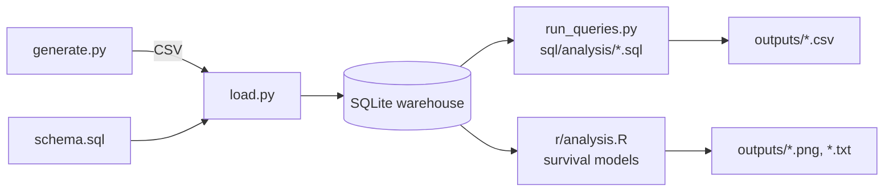

# Patient Flow Analytics: SQL and R on Synthetic Hospital Data

A small analytics warehouse for hospital admissions. It generates synthetic patient records, loads them into a relational schema, answers operational questions with plain SQL, and fits a 30-day readmission survival model in R.

**All data is synthetic.** The generator uses a seeded random number generator and no real patient records are used.

## What it covers

| Question | Method | File |
|---|---|---|
| How long do patients stay, by condition? | `AVG`, `GROUP BY`, `CASE` | `sql/analysis/01_length_of_stay_by_condition.sql` |
| What share of discharges are readmitted within 30 days? | `LEAD()` window function, date arithmetic | `sql/analysis/02_readmissions_30_day.sql` |
| How many beds are occupied each week? | Recursive CTE, range join | `sql/analysis/03_weekly_bed_occupancy.sql` |
| Who is admitted as an emergency, by age band? | Derived age, `CASE` banding | `sql/analysis/04_emergency_admissions_by_age_band.sql` |
| Does condition, age, sex or admission type predict readmission timing? | Kaplan-Meier and Cox model in R (`survival`) | `r/analysis.R` |

## Results (seed 42, 2,000 patients)

- 1,504 admissions, 1,502 discharges eligible for 30-day follow-up, 67 readmissions.
- Mean length of stay runs from 3.3 days (appendicitis) to 8.3 days (heart failure).
- 30-day readmission rates sit between 3.8% and 5.6% across conditions.
- The Cox model finds no condition, age band, sex or admission type effect at the 5% level (smallest p-value 0.063, for sex).

The last point is expected. The generator does not plant a readmission effect, so the model should find none. The pipeline is the point of the project, not the clinical finding. See *Limitations*.

## Architecture



## Quick start

Requires Python 3.10+, and R 4.x with `DBI`, `RSQLite`, `survival`, `ggplot2`, `dplyr` and `testthat` for the R parts.

```bash
pip install -e ".[dev]"
python -m patient_flow.generate       # writes data/raw/*.csv
python -m patient_flow.load           # builds data/patient_flow.db
python -m patient_flow.run_queries    # writes outputs/0*.csv
Rscript r/analysis.R data/patient_flow.db
```

Run the tests:

```bash
pytest
Rscript -e 'testthat::test_dir("r/tests/testthat", stop_on_failure = TRUE)'
```

## How the tests check the SQL

`tests/test_queries.py` builds a four-admission fixture where every answer can be worked out by hand. For example, one patient is readmitted nine days after discharge, so the pneumonia readmission rate must be 0.5. A second fixture discharge falls after the 30-day cutoff and must be excluded. These checks catch off-by-one date errors and wrong window partitions, which passing row counts alone would miss.

## Design decisions

- **SQLite for portability.** The warehouse runs anywhere with no server. The SQL uses `julianday()` and `DATE()`, which are SQLite functions. Porting to PostgreSQL means replacing these with interval arithmetic. Each file notes the dialect.
- **Dates as ISO text.** This keeps the schema simple and makes string comparison match date order.
- **Censoring at 30 days.** Discharges without a full 30-day follow-up are excluded from the readmission rate, and survival times are capped at 30 days, so the model does not treat unobserved time as "no readmission".
- **Logic in SQL, modelling in R.** Aggregation and cohort rules stay in the database layer, where they can be reviewed as code. R receives one row per discharge.

## Limitations

- The data is synthetic and carries no planted clinical effects, so the models return null results. Adding a realistic readmission effect, such as higher risk for heart failure or older patients, would let the tests check that the model recovers it.
- The R tests and CI job assume the packages are available from apt on Ubuntu. They have been run locally on R 4.3.3, but the GitHub Actions run is not yet confirmed.
- Coverage is limited to the query logic. The generator is tested for validity, not for realism.

## Project layout

```
sql/schema.sql                 table definitions and indexes
sql/analysis/*.sql             analysis queries (one per question)
src/patient_flow/              generator, loader and query runner
r/analysis.R                   survival analysis entry point
r/R/analysis_functions.R       reusable model and plot functions
tests/                         pytest suite (fixture-based SQL checks)
r/tests/testthat/              testthat suite for model helpers
outputs/                       generated tables, plot and model summary
```

## Licence

MIT. See [LICENSE](LICENSE).
